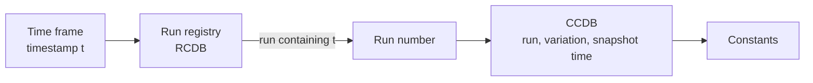

# Streaming readout and runs

CCDB keys calibration constants by run number. A streaming readout has no triggers and no events; the
data arrive as a continuous stream cut into time frames of a few milliseconds. The question experiments
with a streaming DAQ ask first is therefore: *what is a run for CCDB, and what happens when a time frame
needs constants?* This page answers it. The short version: a run is an interval of unchanged detector
configuration, the run registry defines these intervals, and CCDB never needs to know about time frames.

## Two times, and neither is a validity interval

The [conceptual design](conceptual-design.md) separates two times: the time the data were taken, and
the time a declaration was made about which constants to use for a given set of data. CCDB stores only
the second one. An assignment says "for runs *A* to *B*, in variation *V*, use these constants", and
records when that declaration was made (`assignment.created`). A later assignment for the same runs
supersedes it, and the older one stays in the history, so a request made with a time in it returns the
constants that were declared before that time.

So in a request such as

```
/calib/ecal/gains:12345:default:2026-06-01_00-00-00
```

the run number is the data axis and the time is the **snapshot** axis. The time does not mean "constants
valid at that moment of data taking". It means "the state of the declarations as of that moment". This
distinction is what makes production reproducible, and it does not change for streaming.

## What a run is in a streaming experiment

A triggered DAQ starts and stops runs; a streaming DAQ also does, because the reasons for a run boundary
are not about triggers. The detector configuration changes: high voltage, thresholds, readout firmware,
beam conditions, a fill, a maintenance access, a DAQ restart. Between two such changes the constants
that depend on the configuration are the same, and that interval is what CCDB calls a run.

The definition, stated once:

> A run is the interval during which the detector configuration did not change. The **run registry**
> is the authority on where runs begin and end, and it maps any wall-clock time to the run that
> contains it.

At Jefferson Lab the run registry is [RCDB](https://github.com/JeffersonLab/rcdb), the Run Conditions
Database: run number, start and end time, and the conditions that were constant for the run (beam
energy, trigger and DAQ configuration, target, and so on). If a streaming DAQ ever produces data with no
run boundaries of its own, the run registry opens epochs itself, on every configuration change or at a
fixed length, and numbers them. Either way the calibration side sees run numbers.

## Resolving constants for a time frame

A time frame carries a timestamp. Constants for it are resolved in two steps:



1. The run registry maps the timestamp to the run whose interval contains it.
2. CCDB resolves the constants for that run, the chosen variation and the chosen snapshot time, exactly
   as it does for a triggered experiment.

In most reconstruction code the first step is already done: the stream carries the run number in its
headers, and the framework hands the run number to CCDB at run change. The request string and the C++,
Python and Java APIs are unchanged. A time frame boundary is not a CCDB concept, and does not need to
be.

## What belongs where

Not everything that varies with time is a calibration constant. The split that has worked at GlueX:

| kind of quantity | example | where it lives |
|---|---|---|
| Changes when the setup changes | gains, pedestals, timing offsets, alignment, dead channel lists | CCDB assignment with a run range |
| Drifts within a run | temperature corrections, clock drift, pressure | a time series: the slow-controls archive, or a CCDB table with a time column that the client interpolates |
| Describes the run | beam energy, trigger configuration, target, DAQ settings | the run registry (RCDB) |
| Maps time to run | run start and end | the run registry (RCDB) |

A quantity that drifts within a run can still be stored in CCDB: a table with a time column and one row
per sample is a constant set like any other, assigned to the run range it was measured for. What CCDB
does not do is interpolate; that is the client's job, and the sampling is the experiment's choice.

## Reproducibility

A production campaign fixes two things in its context: the variation, and the snapshot time at which the
campaign started. Every job of the campaign then resolves the same constants for the same run, however
many new assignments calibrators add meanwhile. Later campaigns move the snapshot time forward. This is
the mechanism described in [Concepts illustrated](concepts.md#requests), and it is the same for
streaming and triggered data.

## Simulation

Simulated data have no run of their own. The practice is to simulate a data-taking period by giving the
simulation the run numbers of that period and reading constants in a variation made for simulation
(`mc` in the standard layout), which inherits everything from `default` that it does not override. The
run registry is not involved; the run numbers are the link between the simulated and the real period.

## Scale

Streaming computing models process many jobs at once, and every job reads its constants at start and
at every run change, so the load on the calibration database is a burst, not a steady stream. The same
run period means the same constants for thousands of jobs, which is what makes snapshots work: a SQLite
copy of the database, or a shallow copy holding one run period, serves a farm with no database server
in the loop. [Deploying CCDB for a new experiment](../deployment/new-experiment.md#serving-constants-to-jobs)
describes the options.

## CCDB and RCDB

CCDB and RCDB are two focused tools built on the same model: the run is the unit, each has Python and
C++ APIs and a web interface, and they have been used together at GlueX for over a decade. A new
experiment needs CCDB from its first test beam, when constants must be versioned and software must not
break on new ones. It needs a run registry once there are runs to keep books on. The two can be
deployed together on one database server, and merging them into one package is on the roadmap below.

## Roadmap

None of the following is in CCDB 2.4.0. It is listed so that the direction is clear.

- **Validity-time assignments.** An assignment gets a time range as an alternative to a run range; a
  request accepts a validity timestamp; resolution picks by time when no run is given. Existing data
  stay valid under an implicit "all time" range, and the request string keeps its shape. The schema
  already has an `eventRanges` table for finer-than-run validity that no API uses yet
  (see [database schema](database-schema.md#eventranges)); the time range follows the same pattern.
- **Snapshot tags.** A name for a variation plus a snapshot time, so that a campaign pins its constants by
  name. The schema has unused `tags` tables for this.
- **HTTP access.** A read-only HTTP API with immutable URLs for exact assignments, and a bundle per run
  that a job downloads once, so that farms read through ordinary HTTP caches instead of database
  connections.
- **One package with RCDB**, so that time-to-run and run-to-constants are one call.
