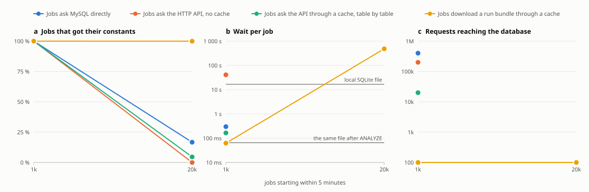

# Scaling: constants for thousands of jobs

When a campaign starts, thousands of jobs start within minutes, and each reads a few hundred tables before
its first event. This page measures how each way of serving constants copes with that burst, on a database
shaped like a production one, and says what to deploy. The short answer: **put a cache in front**. Behind a
cache the database answers each distinct request once, whether jobs read tables one by one or download a run
bundle; what remains is the bytes the cache moves. Anything that reaches the database for every job hits a wall.

## Method

- **Database.** `scripts/loadtest/make_db.py` builds a synthetic database from the table shapes of Hall D's
  production database (679 tables; rows, columns, mean data size and the share of identical data per table, from
  a read-only survey), with the assignments scaled to a tenth: 82 541 assignments, 59 026 constant sets, run
  numbers 0–99 999. The same file serves as MySQL (MariaDB 10.5, `max_connections` 151 as shipped, a 128 MB
  buffer pool) and as SQLite.
- **Jobs.** `scripts/loadtest/client.py` starts N jobs at random moments of a 300-second window. Each job reads
  200 tables (the same 200 for all, as reconstruction jobs do) for one of 100 runs, at a fixed campaign time, in
  the order a job reads them at its first event, and records how long it waited for its constants. Jobs that have
  not started 900 seconds after the first are abandoned and count as failed.
- **Configurations.**
  - *MySQL directly*: one connection per job, the queries the C++ library sends, then close.
  - *HTTP API, no cache*: the API container (4 workers) on the database; one request per table, by request
    string with the campaign time, so every URL names fixed constants.
  - *HTTP API behind nginx*: the same, through the shipped nginx configuration (`docker/nginx/ccdb-api.conf`),
    started with an empty cache.
  - *Run bundle per job behind nginx*: one request per job for the SQLite file of its run
    (`/api/v1/bundle?run=…&time=…`), which the C++ library then reads locally. A bundle holds one set of every
    table of the database, 679 here, and the database has the production shapes, including tables whose sets are
    12 MB field maps: a bundle is **69 MB**, so this configuration moves 69 MB per job where the per-table one
    moves what 200 tables need. The API builds at most four bundles at a time per worker.
  - *SQLite snapshot*: each job opens its own copy of the whole database on a local disk. There is no shared
    server, so the number of jobs does not matter; 100 jobs run 12 at a time to give the cost of one job. The
    file is measured as written and after `ANALYZE`.
- **Host.** One machine for the client and every server: AMD Ryzen 9 5900X (12 cores, 24 threads), 62 GB,
  local NVMe; the client runs 12 processes in a memory-capped cgroup, and the containers carry memory limits. Each table gives the start skew: how much later than planned the
  client started a job. A large skew (‡) means the client, not the server, was the limit of that run, and the
  numbers of that row are a lower bound on what the server could do.
- **Reading the tables.** *Job waits* is the time from a job's start to its last table; *backend requests* are
  those the database or the API had to answer (for nginx: misses).

The raw results are JSON files; `scripts/loadtest/report.py` turns them into the tables and charts below, and
the documentation check fails when they differ.

## Results

<!-- loadtest:begin -->

### MySQL directly

| jobs | failed jobs | job waits, median | p99 | request p99 | requests/s | backend requests | start skew p99 |
|---:|---:|---:|---:|---:|---:|---:|---:|
| 1 000 | 0 (0.0%) | 299 ms | 594 ms | 12 ms | 1 339 | 402 000 | 0.9 ms |
| 20 000 | 16 661 (83.3%) | 9.1 ms | 17.2 s | 880 ms | 4 379 | 1 342 278 | 87 ms |

Errors: OperationalError 1040 (16 661 at 20 000 jobs).

### HTTP API, no cache

| jobs | failed jobs | job waits, median | p99 | request p99 | requests/s | backend requests | start skew p99 |
|---:|---:|---:|---:|---:|---:|---:|---:|
| 1 000 | 0 (0.0%) | 41.0 s | 74.1 s | 683 ms | 592 | 200 000 | 4.5 ms |
| 20 000 | 20 000 (100.0%) | 779 s | 936 s | 211 s | 376 | 359 782 | 1.4 s ‡ |

Errors: ReadError (3 at 20 000 jobs); RemoteProtocolError (1 313 at 20 000 jobs); unfinished at the client's time limit (20 000 at 20 000 jobs).

### HTTP API behind nginx, a request per table

| jobs | failed jobs | job waits, median | p99 | request p99 | requests/s | backend requests | start skew p99 |
|---:|---:|---:|---:|---:|---:|---:|---:|
| 1 000 | 0 (0.0%) | 165 ms | 10.5 s | 67 ms | 667 | 20 000 | 14 ms |
| 20 000 | 19 084 (95.4%) | 745 s | 889 s | 42.4 s | 2 122 | 20 000 | 119 ms |

Errors: unfinished at the client's time limit (19 084 at 20 000 jobs).

### HTTP API behind nginx, a run bundle per job

| jobs | failed jobs | job waits, median | p99 | request p99 | requests/s | backend requests | start skew p99 |
|---:|---:|---:|---:|---:|---:|---:|---:|
| 1 000 | 0 (0.0%) | 63 ms | 14.0 s | 14.0 s | 3 | 100 | 15 ms |
| 20 000 | 7 (0.0%) | 484 s | 1050 s | 1050 s | 16 | 100 | 340 ms |

Errors: ReadTimeout (7 at 20 000 jobs).

### SQLite snapshot on a local file system

| jobs | failed jobs | job waits, median | p99 | request p99 | requests/s | backend requests | start skew p99 |
|---:|---:|---:|---:|---:|---:|---:|---:|
| 100 | 0 (0.0%) | 16.7 s | 19.4 s | 213 ms | 250 | 40 200 | 87.5 s ‡ |

### SQLite snapshot with ANALYZE statistics

| jobs | failed jobs | job waits, median | p99 | request p99 | requests/s | backend requests | start skew p99 |
|---:|---:|---:|---:|---:|---:|---:|---:|
| 100 | 0 (0.0%) | 65 ms | 224 ms | 4.6 ms | 670 | 40 200 | 13 ms |
<!-- loadtest:end -->

## What the numbers say

- **MySQL directly works for a thousand jobs and breaks at twenty thousand.** At 1 000 jobs every job has its
  constants in 0.3 s. At 20 000, the server's connection limit (151) turns 83 % of the jobs away with "Too many
  connections"; the median of the rest is meaningless. More connections would move the cliff, not remove it:
  every job costs the server two queries per table.
- **The API without a cache is the database with more work per request.** Four workers answer 600 requests per
  second; a thousand jobs of 200 tables already wait 41 s each, and at 20 000 jobs no job finishes within 15
  minutes. The API is not a way to scale by itself.
- **A cache in front changes the kind of problem.** Behind nginx, 1 000 jobs read 200 000 tables in 0.17 s per job
  with the database seeing 20 000 requests, one per distinct URL. At 20 000 jobs the database still sees 20 000
  requests, and the limit moves to the cache path: this host moved 2 100 requests per second through one nginx and
  a Python client on the same machine, 6× short of the 13 000 per second that 20 000 jobs starting within five
  minutes need; the run shows the client's time limit, not a database limit. Production puts the cache on other
  hosts than the jobs and runs several of them, which this measurement could not (one host).
- **A SQLite snapshot costs no server at all, and its cost per job depends on one detail.** The file as the
  `ccdb` tools write it makes a 200-table job wait 17 s, because the C++ library's query walks every assignment of
  the variation; the same file after `ANALYZE` answers in 65 ms. Until finding F28 is fixed in the library, run
  `ANALYZE` on every snapshot you publish.

- **A run bundle per job keeps the database out of the picture, and moves the bundle's bytes instead.** For 1 000
  jobs the database built 100 bundles, one per run, and every job had its constants in 63 ms. For 20 000 jobs the
  database still answered 100 requests and 19 993 jobs got their constants, but a job waited 484 s in the middle:
  20 000 × 69 MB is 1.4 TB, more than one host moves in five minutes. The bundle is the right unit when the jobs
  of a run share it (one download per node, or a bundle on a shared file system), or when it is small; a bundle of
  only the tables a job reads is on the roadmap.

The figure reads as follows: a path that stops delivering (panel a) ends in panels b and c, since the wait and
the requests of a run that failed say nothing about the path. The measurements have two points per path, at
1 000 and 20 000 jobs; a sweep over more sizes on separate client and server hosts is planned (Q58).
