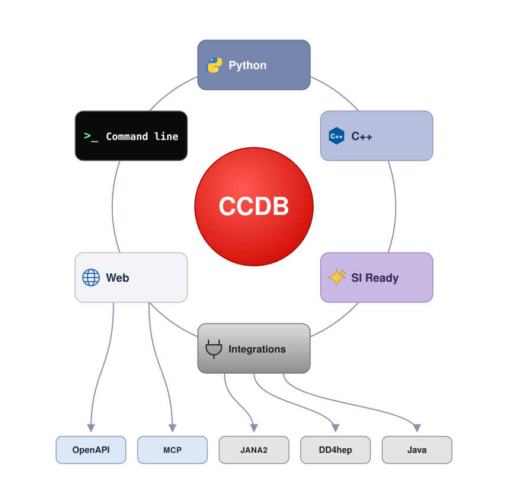
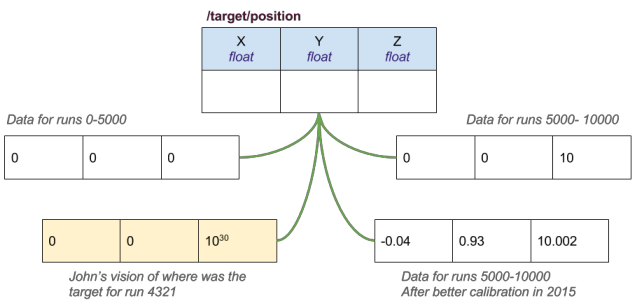

## CCDB

The **Calibration Constants Database (CCDB)** stores and serves the calibration constants that
reconstruction of a detector's data needs. Each sub-detector has its own tables, its constants change
with run number at boundaries of its own, and the best constants for a given run change again as
calibration improves. CCDB keeps track of all of it.



## Features

CCDB has been in production at GlueX, Jefferson Lab, since 2012. The [Quick start](#quick-start)
connects you to that database read-only.

### Data model

- **[Structured, typed constants](concepts/concepts.md#table-types).** Every constant set is a table
  with named, typed columns (`int`, `double`, `string`, `bool`) and a fixed shape, stored at a path such
  as `/ecal/gains`. The database knows the shape, so it can display, validate and compare values, and
  reading code addresses `data["z"]` by name.
- **[Validity by run range](concepts/concepts.md#constant-sets-and-assignments).** Constants are assigned to run ranges,
  for example runs 1000 to 2000, and each table has its own boundaries. A request names a run and gets
  the constants valid for it.
- **[Branching (variations, with inheritance)](deployment/new-experiment.md#variations).** Branches
  such as `mc` or a calibrator's work branch hold their own constants and inherit everything else from
  the parent, up to `default`. Production reads `default`; work in a branch changes nothing there.
- **[Every version kept, retrievable by date](concepts/conceptual-design.md).** History is a first axis
  of the data model: a request with a date returns the constants as they were on that date. A campaign
  that fixes its branch and date gets the same constants in every job and can be repeated years later.
- **[Nothing is deleted (logbook principle)](cli.md#commands-overview).** CCDB is designed as a
  calibration logbook: a new assignment supersedes the old one and the old one stays; tables and
  branches that fall out of use are deprecated, which hides them from listings and keeps them answering
  old code.
- **[Who, when and why on every change](cli.md#commands-overview).** Author, time and comment are
  recorded on every assignment, table and branch. The log is searchable with `ccdb log` and in the web
  GUI.
- **Named snapshots (tags).** A tag names a branch plus a date, so a production campaign pins its
  constants by one name and the name resolves to the same constants forever.
- **Content hashes.** Every constant set carries its SHA-256, so identical sets are stored once and
  any copy can be verified against the source.

### Central database, local copies and farm scale

- **[Central database with native clients](deployment/new-experiment.md#serving-constants-to-jobs).**
  MySQL or Postgres holds the master copy; the C++, Python and Java APIs read it directly, with
  connect, read and write [timeouts](apis/cpp.md#timeouts-and-reconnect) and automatic reconnect.
- **[SQLite snapshots](deployment/new-experiment.md#serving-constants-to-jobs).** The whole database
  exports to one file for CVMFS, shared file systems, containers and laptops. A farm reads the snapshot
  with no database server in the loop, since every job of a campaign needs the same constants.
- **[Shallow copies per run period](https://github.com/JeffersonLab/ccdb/tree/v2-main/scripts/shallow_copy).**
  A few megabytes of SQLite hold what one run range, one date and chosen branches need, and answer
  lookups identically to the source.
- **HTTP API with immutable URLs.** Constant sets and per-run bundles are served over HTTP with
  cache-friendly immutable addresses, so tens of thousands of jobs starting at once read from ordinary
  HTTP caches. The C++ client downloads a run bundle and opens it as a local SQLite file.
- **[Same program, any source](deployment/new-experiment.md#serving-constants-to-jobs).** Switching
  between the central database, a snapshot, a shallow copy and the HTTP API is a change of the
  connection string.

### AI and agent ready

- **MCP server (read-only).** Agents browse the tree, read constants, compare versions and search the
  log through the Model Context Protocol, with the concepts pages shipped as a resource. Writes are not
  exposed.
- **OpenAPI document.** Every HTTP endpoint and its typed JSON are described in an OpenAPI document,
  ready for generated clients and tool definitions.
- **Self-describing tables.** Each table carries column descriptions and units, a JSON Schema and a
  generated data card, so a program or an agent understands a constant set without a human in the
  loop.
- **FAIR metadata.** License, citation and instance metadata are served with the data and written into
  every export.

### Framework integrations

- **JANA2 service.** A `CCDB_service` in the EICRecon style hands factories a calibration object per
  run with typed getters; branch and date come from parameters.
- **DD4hep conditions.** A conditions loader maps a CCDB table to DD4hep conditions with a run
  interval of validity, alignment deltas being the worked example, plus geometry constants from the
  database at parse time.
- **Model weights and external files (resources).** A resources table records URL, SHA-256, size and
  metadata of files such as ONNX models; the file lives in object storage or CVMFS and the client
  fetches and verifies it.
- **Parquet export and DataFrames.** A snapshot exports to Parquet, one file per table, for DuckDB,
  polars and pandas.

### Runs, time and streaming readout

- **[Run as the unit of validity](concepts/streaming-readout.md).** A run is an interval during which
  the detector configuration did not change. In a streaming experiment the run registry maps a time
  frame to its run, and CCDB resolves run, branch and date to constants; validity by time range is on
  the [roadmap](concepts/streaming-readout.md#roadmap).
- **[CCDB with RCDB](concepts/streaming-readout.md#ccdb-and-rcdb).** RCDB, the Run Conditions Database,
  keeps run start and end times and per-run conditions; CCDB keeps the constants. Both have Python and
  C++ APIs and a web interface and have run together at GlueX for over a decade.

### Tools and deployment

- **[Web GUI with version comparison](deployment/webgui.md).** The GUI browses the tree, lists a
  table's versions, shows any two side by side with changed cells marked and downloads the difference
  as a unified diff.
- **[Command line shell](cli.md).** The `ccdb` shell works on the tree with `ls`, `cd`, `vers`, `cat`
  and `add`; one `pip install ccdb`.
- **[Deployment guide](deployment/new-experiment.md).** Accounts, tree layout, branch policy,
  run-range rules, serving constants to jobs and backups, each with the choice that has worked at GlueX
  since 2012, and a checklist.
- **Published load tests.** Three configurations measured against a production-sized database at
  20 000 and 100 000 simultaneous clients, with median and tail latency.

## A simple example

Take a simple example of calibration data, say "target position," which is defined by three
coordinates x, y, z, each represented by a floating point number.

Using C++ as an example language, if a user asks for "target position":

```cpp
auto data = calibration->GetCalib("/target/position");
```

the calibration database provides the appropriate data in the current context so it can be used
like:

```cpp
if (data["z"] > 30) ...
```

"The **current context**" is the key phrase here, since the values of target position could be
different for different runs, values may be updated with time (e.g. if more precise calibration is
performed), and a user may want to use a personal version of constants.



The picture above illustrates features of CCDB that involve control of the context:

- The data can be addressed by filesystem-like paths (`target/position`)
- The returned data depends on a run number.
- A history mechanism: by default CCDB honors the last assignment of data to a particular run, but
  one can always recover values stored in the past.
- Variations (equivalent to "branches" in version control systems): users have the ability to
  create and work with alternative versions of the data, varying the run assignments and/or the data
  itself.

## Quick start

The `ccdb` command and the Python API are distributed on [PyPI](https://pypi.org/project/ccdb/):

```bash
python -m pip install --upgrade ccdb
```

After installation you have:

- the `ccdb` Python library,
- the `ccdb` command, to work with CCDB in the terminal (also runnable as `python -m ccdb`).

Try it against the HallD read-only database, for example:

```bash
export CCDB_CONNECTION="mysql://ccdb_user@hallddb.jlab.org/ccdb"
ccdb -i              # start the interactive shell
```

Continue with:

- [Installation](get-started/installation.md) — all installation options (pip/uv, source, C++, MySQL)
- [Command line interface](cli.md) — the `ccdb` tool
- [Concepts illustrated](concepts/concepts.md) — namepaths, table types, assignments, requests
